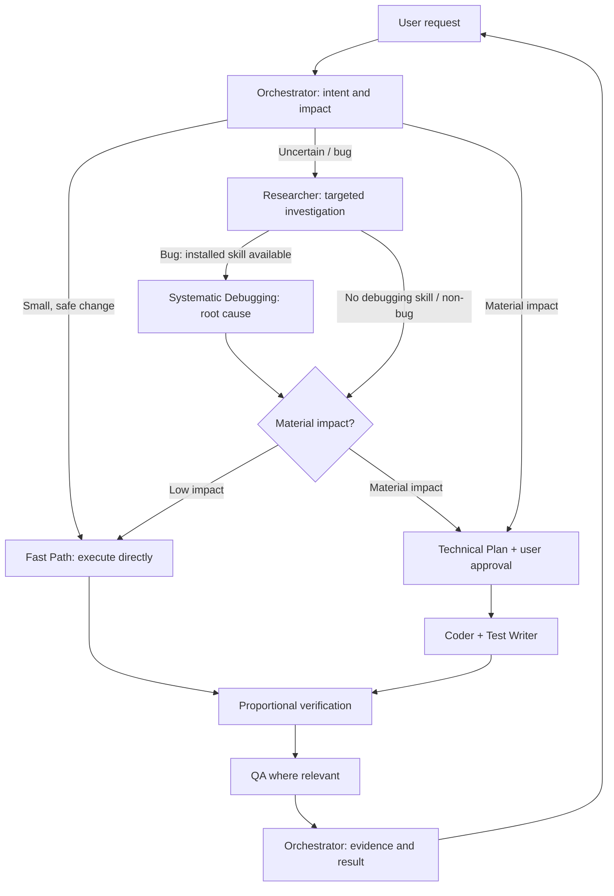

# My AI Setup

Portable AI development workflow for Codex, Claude Code and Gemini CLI. The Orchestrator selects the appropriate path based on task impact, delegates specialist roles when available, and reports actual verification results.

## Architecture & workflow



Five roles: **Orchestrator** (decisions and coordination), **Researcher** (read-only findings), **Coder** (implementation), **Test Writer** (automated coverage), and **QA** (runtime validation). When native subagents aren't available, the workflow uses sequential role-scoped execution. Small changes don't require a plan; material business or technical impact does.

**Optional integrations:** Caveman (concise responses), RTK (compressed terminal output), Systematic Debugging (root-cause investigation for bugs, test failures, and unexpected behavior). Systematic Debugging is routed automatically **only if installed and accessible**; no tool is silently installed. Core workflow and approval boundaries take precedence.

## Setup

Install the core skill globally:

```bash
npx skills add rifqicode/my-ai-setup --skill my-ai-setup -g -y
```

Run the optional integrations installer from the installed skill directory (path may vary by CLI):

```bash
node ~/.agents/skills/my-ai-setup/integrations/setup.mjs --dry-run
node ~/.agents/skills/my-ai-setup/integrations/setup.mjs --agent codex
```

The second command asks which integrations to enable. To install only debugging:

```bash
node ~/.agents/skills/my-ai-setup/integrations/setup.mjs --only systematic-debugging
```

Restart your coding agent after installation. The integration installer is separate from `npx skills add`; nothing extra installs automatically. See [setup details](integrations/README.md) and [installation notes](docs/installation.md).
