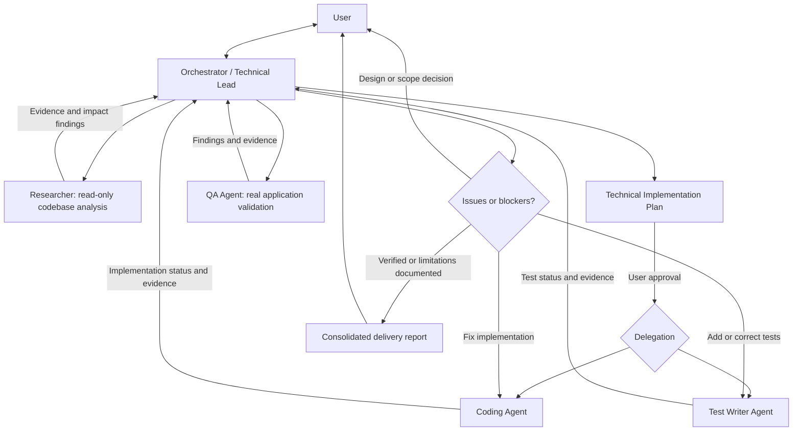

# My AI Setup

> **Status: Architecture Draft — not yet installable.**

Portable AI development team workflow intended for Codex CLI, Gemini CLI, and Claude Code. The goal is a single GitHub-hosted source of truth, eventually installable on a new computer with one command.

## Team architecture

**Five roles, one Orchestrator.** The user discusses requirements and technical decisions only with the Orchestrator. Specialist agents perform scoped work and return evidence-based results.

| Role | Responsibility | Output |
| --- | --- | --- |
| **Orchestrator / Technical Lead** | Brainstorm requirements and trade-offs with the user; request codebase investigation; author and maintain the Technical Implementation Plan; delegate, track progress, triage issues, and consolidate results. | Approved Technical Plan, progress overview, consolidated report |
| **Researcher** | Read-only codebase exploration: trace existing behavior, architecture, dependencies, impacted modules, and relevant conventions; report findings with file/function references and distinguish evidence from assumptions. | Codebase findings and impact analysis |
| **Coding Agent** | Implement scoped features and fixes based on the approved Technical Plan. | Code changes, implementation notes, verification evidence |
| **Test Writer Agent** | Derive happy-path, negative, boundary, concurrency, and relevant edge-case scenarios; implement automated tests against the approved plan. | Test scenarios, automated tests, results and coverage gaps |
| **QA Agent** | Independently validate the real application using available Playwright/browser/CLI tools; report defects with reproduction steps and evidence. | QA findings, execution evidence and verification status |

## Architecture



Researcher is invoked when understanding the existing codebase would materially improve the design or investigation, **not on every conversation turn**. Researcher never modifies source code or decides architecture independently.

## Technical Plan is the task contract

The Orchestrator's **Technical Implementation Plan is the single source of truth** for approved scope and agent assignments. Do not duplicate it into separate task-contract documents.

At minimum, the plan should communicate:
- Problem, goals, scope, constraints, and relevant existing-system findings.
- Technical design, significant decisions, and unresolved questions.
- Implementation tasks, owners, dependencies and acceptance criteria.
- Test scenarios and QA validation expectations.
- Progress and verification evidence per task.

Each agent follows its assigned part of the approved plan and sends status/results back to Orchestrator. Only Orchestrator consolidates updates into the plan to avoid concurrent edits.

### Progress model

| Work status | Meaning |
| --- | --- |
| `TODO` | Not started |
| `IN_PROGRESS` | Actively being worked on |
| `BLOCKED` | Waiting on dependency, decision, or environment; reason required |
| `DONE` | Assigned work completed with evidence |
| `SKIPPED` | Not applicable, with reason |

Track **work status separately from verification status** (e.g. `NOT_RUN`, `PASS`, `FAIL`, `BLOCKED`). Coding `DONE` does **not** imply QA `PASS` or release readiness. All reported test outcomes must reflect actual tool execution.

Agents report status changes at meaningful milestones (start, completed, blocked) with their task ID, outputs, executed checks, blockers, and limitations. This is a logical reporting contract; a separate tracker or YAML file is not required in v1.

## Proposed development workflow

1. **Discuss:** User and Orchestrator clarify goals and requirements.
2. **Research:** Orchestrator delegates relevant existing-codebase investigation to Researcher and evaluates the findings.
3. **Plan:** Orchestrator produces the Technical Implementation Plan and obtains user approval for major decisions.
4. **Execute:** Coding Agent implements; Test Writer writes automated tests, potentially in parallel when contracts and file ownership allow.
5. **Check:** Run appropriate automated checks and consolidate real results.
6. **Validate:** QA Agent verifies actual behavior through available browser/Playwright/CLI tools, independently of code authorship.
7. **Triage and rework:** QA findings return to Orchestrator, which delegates fixes or requests clarification and coordinates targeted retesting. Avoid unbounded fix loops; repeated failures trigger root-cause review.
8. **Report:** Orchestrator reports task progress, verification evidence, unresolved risks, and outstanding decisions to the user.

Not every task needs every specialist; orchestration adapts to the complexity and risk. Specialists must not independently expand scope or approve major design changes.

## Portability decision: Hybrid

- **Shared specification:** One host-neutral definition of roles, workflow, and output expectations.
- **Native delegation when available:** Use the selected CLI's supported subagent mechanism.
- **Sequential fallback:** Where genuine delegation is not available, run explicitly role-scoped stages one after another.
- **Honest evidence:** Do not claim isolated agents, parallelism, tool execution, or QA checks that did not actually occur.
- **Installability:** Target a one-command installation; host-specific adapters and install mechanics are not yet built.

## Proposed repository structure (not yet implemented)

```text
my-ai-setup/
├── README.md
├── SKILL.md
├── agents/
│   ├── orchestrator.md
│   ├── researcher.md
│   ├── coder.md
│   ├── test-writer.md
│   └── qa.md
├── workflows/
│   └── development.md
└── adapters/
    ├── codex/
    ├── gemini/
    └── claude/
```

## Next design topics

- Detail Orchestrator-to-agent handoffs and evidence format without introducing duplicate documents.
- Define safeguards for parallel execution and file ownership.
- Determine completion criteria and escalation triggers for repeated failures.
- Validate cross-CLI one-command installation and adapter behavior.
- Build a minimal cross-CLI proof of concept before calling the workflow operational.
