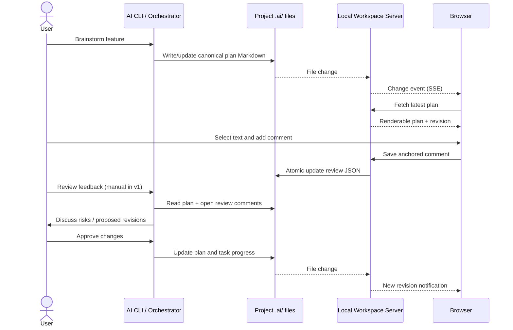

# Local AI Planning Workspace — Architecture v0.5

> Status: Draft for review. Architecture only: the local server, browser UI, CLI bridges and comments API are **not yet implemented**.

## 1. Purpose

When the user brainstorms with an Orchestrator in Codex, Claude Code or Gemini CLI, the Orchestrator writes a **canonical Technical Implementation Plan** in the active project. A local browser displays the plan live, lets the user select text and add inline review comments, and shows agent execution progress and verification status. The Orchestrator can consume review comments and update the plan. This is **local-first**, independent of cloud hosting, and should require minimal machine setup.

## 2. Components and ownership

| Component | Responsibility | Source of truth |
| --- | --- | --- |
| Orchestrator (running in AI CLI) | Discuss, research/delegate, write/revise plan, consume feedback, coordinate agents and progress | `.ai/plans/<id>.md` |
| Local workspace server | Serve browser UI and scoped local API; watch files and notify browser; validate/store reviews | Reads project `.ai/` |
| Browser app | Render Markdown/Mermaid, document navigator, selection/inline comments, approve/reopen review, progress views | No separate authoritative plan copy |
| Review sidecar | Store comment anchors, lifecycle and review decisions independent of Markdown rewriting | `.ai/reviews/<id>.json` |
| Host CLI bridge (future) | Ensure skill knows project root and can read review sidecar; optionally offer explicit refresh/review command | No separate plan |

There is **no automatic autonomous AI invocation in v1**. File changes refresh the browser, but comments only reach the Orchestrator when its active CLI session intentionally reads them (e.g. user asks "process plan comments") or when a later supported integration explicitly triggers a command.

## 3. Logical dataflow



## 4. Project storage

```text
example-project/
├── .ai/
│   ├── plans/
│   │   └── PLAN-20261110-feature.md       # authoritative Markdown
│   └── reviews/
│       └── PLAN-20261110-feature.json     # review comments + approval metadata
├── .codex/
├── .gemini/
├── .claude/
└── src/
```

**Never create independent editable CLI plan copies.** The global `my-ai-setup` install supplies workflow rules and reader tooling; project-specific documents live in each target project. Commit plans/reviews only when appropriate and sanitize sensitive data. Local transient files, cache and server tokens must not be committed.

## 5. Review sidecar schema (conceptual)

```json
{
  "schemaVersion": 1,
  "planId": "PLAN-20261110-feature",
  "comments": [
    {
      "id": "comment-001",
      "sectionId": "proposed-architecture",
      "quote": "Process all refunds through a queue.",
      "anchorRevision": "sha256:<document-content-hash>",
      "contextBefore": "Payment provider selection",
      "contextAfter": "Retry policy",
      "status": "OPEN",
      "body": "Why not reuse the current synchronous payment flow?",
      "createdAt": "2026-11-10T00:00:00Z",
      "resolvedAt": null
    }
  ],
  "approval": {
    "status": "IN_REVIEW",
    "approvedRevision": null,
    "approvedAt": null
  }
}
```

Illustrative values only, not a live review record. A production schema should use a robust anchor algorithm (section identifier + selected quote + adjacent context + document revision) and mark anchors `UNMATCHED` on ambiguous relocation. Do not silently attach a comment to different text.

Status meanings:
- Comment: `OPEN` / `RESOLVED` / `OUTDATED` (anchor invalidated).
- Plan review: `DRAFT` / `IN_REVIEW` / `APPROVED`.
- Agent task: existing work and verification status fields in Technical Plan.

Approval is **revision-bound**: the approved hash must match the latest plan hash. If substantive plan content changes, approval becomes stale and requires review; do not silently reapprove. UI should show both latest revision and approval revision.

## 6. Local API and live updates (proposed)

Use a server bound to `127.0.0.1` by default and rooted at the current project workspace.

| Endpoint | Behavior |
| --- | --- |
| `GET /api/plans` | List known plan IDs/status/revisions |
| `GET /api/plans/:id` | Get Markdown content and content revision |
| `GET /api/plans/:id/reviews` | Get comments, anchors, review status |
| `POST /api/plans/:id/comments` | Add comment anchored to supplied revision and selection |
| `PATCH /api/plans/:id/comments/:commentId` | Resolve/reopen comment |
| `POST /api/plans/:id/approval` | Approve **current hash**, reject stale revision |
| `GET /api/events` | Server-Sent Events for plan/review/status changes |

Design rules:
- Enforce project-root path sandboxing and reject traversal/symlink escapes.
- Require validated `Origin`, non-ambient CSRF protection/token for writes, and avoid wildcard CORS even on localhost.
- No arbitrary file-write or shell execution API. Browser comments cannot directly execute prompts or commands.
- Use atomic JSON file writes (temp + rename) and optimistic revision checks to prevent comment/approval lost updates.
- Render untrusted Markdown safely: disable raw HTML by default, sanitize content and links; ensure Mermaid rendering does not open script injection paths.
- Server should provide an open-in-browser URL; port is configurable and need not be fixed.

## 7. Workflow boundaries

1. **Brainstorm**: User works with Orchestrator in CLI. Proposed architecture and questions are captured in the plan.
2. **Live read**: File watcher notifies UI, which fetches the newest plan.
3. **Comment**: User highlights text and records an anchored review comment. Comment does *not* alter plan content.
4. **Review handoff**: On user request, Orchestrator reads pending comments and proposes responses/changes. Comments are untrusted user input to be evaluated, not unconditional instructions.
5. **Approve**: User approves a specific plan revision; Orchestrator may dispatch implementation tasks according to agreed approval rules.
6. **Execute**: Agents report work results to Orchestrator; only Orchestrator consolidates into plan. Browser displays work + verification status separately.
7. **Re-review**: Material plan edits invalidate stale approval and require a new approval before dispatch of changed scope.

**MVP limitation:** Browser approval records the user's review action. An inactive CLI session will not automatically resume or dispatch agents based on browser activity.

## 8. MVP scope

**P0**
- Local server bound to loopback, limited to one selected project.
- Render Markdown, tables and Mermaid; sidebar document navigation.
- Watch plan/review files and refresh UI without full page reload.
- Select text, attach inline comments, list open/resolved comments.
- Persist comments and approval metadata in project-local sidecars.
- Approve the current plan revision, with stale-revision protection.
- Display task work status and verification status parsed from Technical Plan.
- Explicit CLI-compatible review workflow: Orchestrator can read sidecar and revise plan on request.

**Later**
- Automatic agent notification/trigger when comments arrive.
- Conversation embedded directly in browser.
- Cross-project dashboard, authentication for network access, multi-user collaboration.
- Rich text editor or real-time shared editing.
- Portable native subagent adapters and device-specific installer hooks.

## 9. Acceptance criteria for the future implementation

1. When the Orchestrator updates a project plan file, an open browser shows its new content without manual reload.
2. A comment anchored to selected text survives ordinary formatting and nearby text changes, or is explicitly marked unmatched if ambiguous.
3. Reloading the browser preserves comments and review status from project-local storage.
4. Approving revision A, then modifying plan to revision B, does not display B as approved.
5. Different project roots cannot read or write each other's plans through the server.
6. The browser cannot start AI commands just by saving a comment.
7. The Orchestrator can read saved comments from project files with Codex, Gemini or Claude CLI access.
8. Agent progress shows `DONE` and `PASS` independently; unexecuted tests never appear as passing.
9. A new computer can run the reader against an existing project's `.ai/` directory using a documented local setup process.

## 10. Open decisions for implementation planning

- Runtime package/distribution: a small Node CLI versus embedding reader binaries in the skills repository.
- How skill installer installs or exposes a `my-ai-setup docs` executable; Agent Skills installation alone does not register a shell command.
- Parser choices and safe Markdown + Mermaid implementation.
- Whether review sidecars are committed to source control by default.
- Optional CLI-specific hooks to notice new comments without unattended agent execution.
